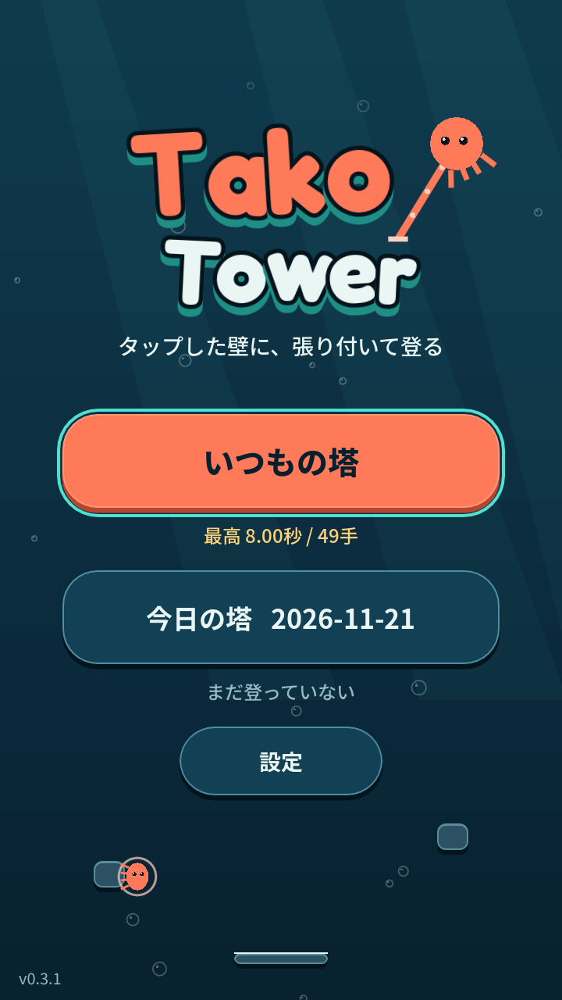
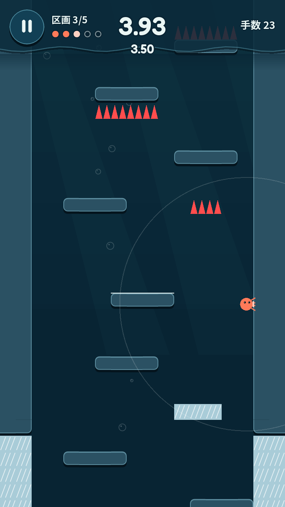
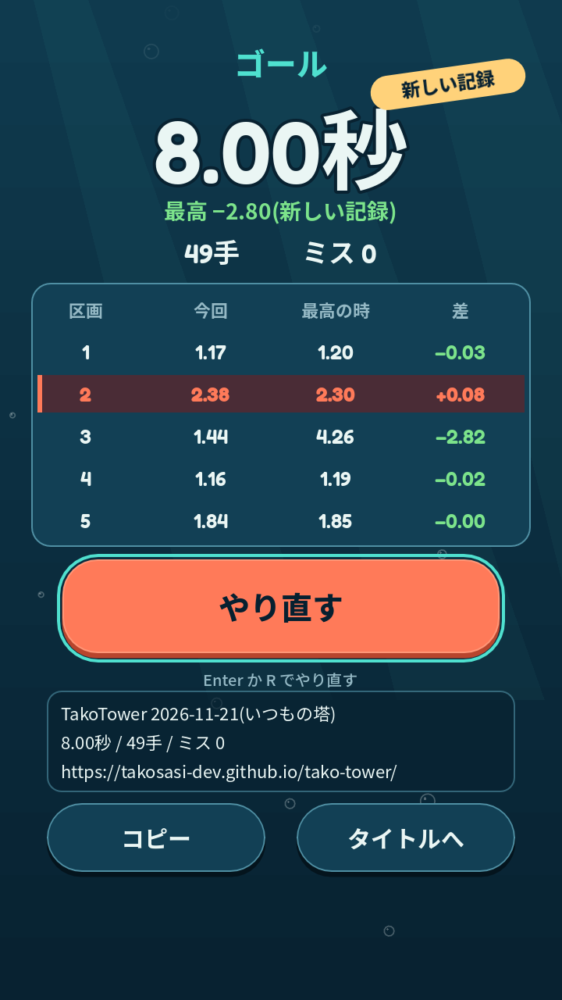

# TakoTower

タコが腕を伸ばして壁に張り付き、体を引き寄せて塔を登るタイムアタックです。画面をタップ(クリック)すると、タコはその向きに腕を伸ばします。腕が壁に届けば、体がそこへ一直線に飛んで張り付きます。ブラウザで開くだけで遊べます。

**▶ 遊ぶ: https://takosasi-dev.github.io/tako-tower/** (デスクトップの Chrome・Edge・Firefox。マウスで遊びます。インストール不要)

> v0.3.1。試作の段階です。腕の届く距離や飛ぶ速さなどの調整値は、まだ人に遊んでもらって決めた値ではありません。ブラウザは、窓なしの Chrome で起動と一通りの流れまで確かめました(下の「開発の状況」)。

<p>



</p>

見た目は「海の中のポップ」です。深い海の青緑に泡と光の帯、タコと同じ珊瑚のボタン、丸い字の題字と数字(v0.3.0)。遊びの画面も同じ海の中にしています(上から差す光と泡・丸い縁の壁と足場、v0.3.1)。

## 遊び方

- 張り付きたい壁をタップします。タコの周りの薄い円が、腕の届く範囲です。
- 腕は、タップした向きへ体と同じ大きさの玉を投げ、最初に触れた物で決まります。張り付ける壁なら、そこへ飛んで張り付きます。
- 飛んでいる途中・張り付いている時・立っている時、いつでも次をタップできます。
- 塔は 5 つの区画でできていて、上へ行くほど新しい物が 1 つずつ増えます。

| 物 | 見た目 | どうなる |
|---|---|---|
| 張り付ける壁 | 縁のある四角 | 張り付ける |
| ツルツルの壁 | 斜めの線の入った明るい四角 | 張り付けない(空振り。0.3 秒、腕が出せない) |
| トゲ | 赤いぎざぎざ | 張り付けない。落ちて触れるとミスで、区画の入口へ戻る |
| もろい壁 | 点線の縁とひび | 張り付くと 0.7 秒で崩れ、3 秒で戻る |

- 時計は最初に張り付いた時から進み、塔の上の線を越えた時に止まります。ミスしても時計は止まりません。
- 区画を越えるたびに、そこまでの時間と自己ベストとの差が出ます。
- 2 回目からは、自己ベストの時のタコが薄い影になって一緒に登ります(設定で消せます)。
- Esc で一時停止、R でやり直し、タイトルで Enter を押すと「いつもの塔」。メニューの画面は矢印キーと Enter でも選べます(腕の操作はマウスとタッチだけです)。

## いつもの塔と今日の塔

「いつもの塔」はいつも同じ並びです。「今日の塔」は日付で決まり、同じ日なら誰でも同じ区画の並びになります。結果画面の文字をコピーして貼れば比べられます。

```
TakoTower 2026-11-19(今日の塔・1回目)
42.58秒 / 61手 / ミス 1
https://takosasi-dev.github.io/tako-tower/
```

## しくみ

- **ゲームの決まりは `core/` にだけ**あります(腕・飛ぶ・落ちる・もろい壁・ミス・区切り・ゴール)。画面は `climb.snapshot()` と `climb.events()` を読んで描くだけです。
- 1/120 秒刻みで進め、入力は塔の中の整数の点だけを受けます。同じ塔と同じ入力の記録なら同じ時間になります。影はこの記録を再生して作ります。
- 区画は手で作り、`data/segments.json` に置いています。12 個の区画と、その左右反転の全部が「腕だけで下から上まで登れる」ことを、本番と同じ腕の判定(`core/cast.gd`)で探して確かめています。
- 保存はブラウザの中(localStorage の `tako-tower/save`)だけです。サーバーとの通信やアクセス解析はありません。

## 動作環境

- Godot 4.7.2-stable(GDScript、レンダラー Compatibility)
- Web 書き出しはスレッド無し・拡張無し
- 画面は縦 720×1280。PC の横長の画面では真ん中に置き、左右は背景色で埋めます。スマホのブラウザは動作の対象に入れていません

## 開発

```
# テスト(全件成功で終了コード 0)
godot --headless --import
godot --headless --script res://tests/run_tests.gd

# 区画の検査(区画ごとの結果と秒数)・塔を腕だけで登る道を探す
godot --headless --script res://tools/check_segments.gd
godot --headless --script res://tools/tower_path.gd -- fixed

# Web 書き出し(書き出しテンプレート 4.7.2 が要る)
godot --headless --export-release "Web" build/web/index.html

# 字体を画面の文字に絞る・効果音を作る・色のコントラスト比を確かめる(Python)
pip install fonttools
python tools/subset_font.py
python tools/gen_sfx.py
python tools/contrast.py

# 画面の部品の見た目(ui/theme.tres)を ui/kit.gd から作り直す
godot --headless --script res://tools/make_theme.gd

# 窓なし・消音・使い捨てのプロフィールの Chrome で、書き出した物を通して確かめ、画面を撮る(Node 22 以上・Chrome)
godot --headless --script res://tools/tower_path.gd -- fixed out=res://build/fixed_path.json
node tests/web/check.mjs          # 画像は build/web_shots/
node tests/web/shots.mjs after    # 全部の画面を 6 つの大きさで撮る(build/web_shots/after/)
TT_URL=https://takosasi-dev.github.io/tako-tower/ node tests/web/check.mjs   # 公開した物
```

`tools/gd.py` は上を窓なしで回す入口です(`python tools/gd.py test` など。Godot の場所は環境変数 `GODOT`)。`?debug=1` を付けて開いた時だけ、ゲームの状態を `window.ttState` に出します(`tests/web` が読む)。

`main` に push すると、GitHub Actions がテスト → Web 書き出し → GitHub Pages への配置を行います(`.github/workflows/pages.yml`)。

## 開発の状況

- v0.3.1。仕様のフェーズ 0〜4 の中身(画面 5 つ・区画 12 個・保存・影・効果音)を作り、テスト(ヘッドレス、64 件)が全部通ります。v0.2.0 で見た目と演出を磨き、v0.3.0 で UI を作り直し、v0.3.1 で遊びの画面の背景と足場をタイトルの海に揃えました(`CHANGELOG.md`)。
- ブラウザ: 窓なしの Chrome(書き出した物と公開した物)で、起動・タイトル・設定・いつもの塔をゴールまで・一時停止(Esc・ボタン・タブが裏に回った時)・結果・コピー・やり直し(影と区切りの差)・ミスから戻る(点滅を弱める・揺れを切るの設定でも)・開き直して保存と設定を読み戻す・横長と縦長の画面・読み込み後 3 分の通信が 0 件・コンソールのエラーが 0 件まで確かめました。入力は本物のマウスのイベント(一部は塔の中の点を直接押す確かめ用の口)と、タッチの模擬です。
- まだ確かめていないこと: 人が遊んだ手触りと調整値・1 回の長さ、本物のマウスとキーボードとタッチ、Edge と Firefox、音の聞こえ方。
- 仕様の「やめる基準」のうち、窓なしで判定できる物(区画のつなぎ目の決まりが成り立つか・検査の時間・区画づくりの時間)は当たっていません。人が遊んで決める物(同じ区画を続けてやり直したくなるか・遊んだ人が別のゲームと同じ遊びだと言わないか)は、まだ判定していません。
- 名前「TakoTower」は仮の名前です。

## ライセンス

MIT(`LICENSE`)。同梱の字体 2 つ(Noto Sans JP と、題字・数字の Fredoka)は SIL Open Font License 1.1 です(`THIRD-PARTY-NOTICES.md`)。
